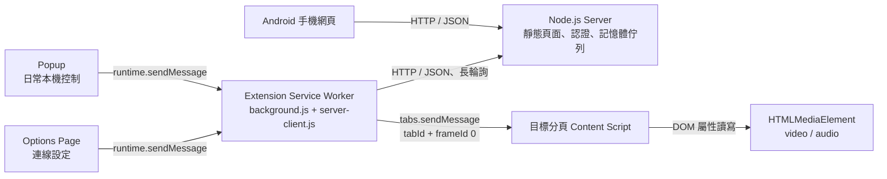
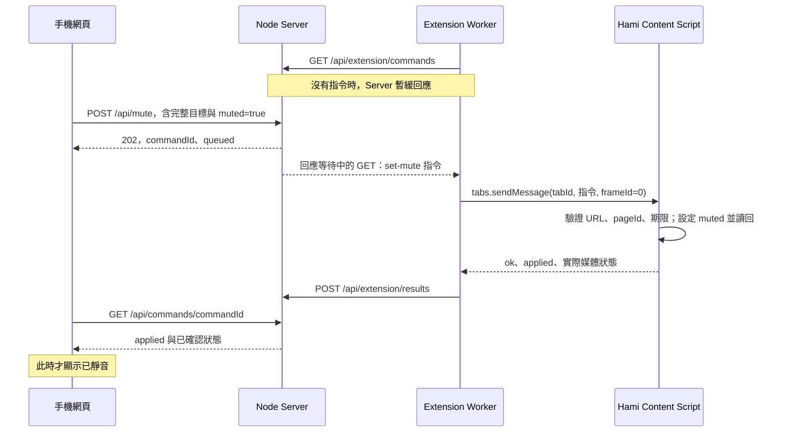

# TabVolumeRemote 架構與 Chrome 擴充功能學習指南

本文件適合已有 Web 開發經驗、第一次接觸 Chrome Extension 的讀者。以目前專案 **0.5.0** 為準，說明元件職責、使用技術、前後端連動方式，以及可搭配原始碼閱讀的官方文件。

操作與安裝見 [README](../README.md)；本文件著重「為什麼這樣設計，以及程式如何一起運作」。

## 1. 從你的使用情境開始

你在主螢幕打遊戲或工作，副螢幕播放 Hami 球賽。廣告開始時用手機靜音，廣告結束再解除，不必切換主螢幕的操作焦點。解除靜音應保留原本音量，其他分頁和 Windows 音量不受影響。

為此，系統需要三項能力：

1. 手機有一個操作介面。
2. 有一個雙方都能連上的地方接收、轉交指令。
3. 電腦瀏覽器裡有能找到指定分頁、操作播放器的程式。

對應元件就是 **Android 網頁、Node.js Server、Chrome／Edge 擴充功能**。手機端目前是一般網站，沒有原生 Android App。

## 2. 系統架構



HTTP 箭頭代表請求的發起方向；Server 可以在回應中交回指令或結果。Chrome 訊息 API 則是瀏覽器內不同執行環境之間的通訊，不是 LAN 網路連線。

### 每個部分能做什麼

| 部分 | 本專案職責 | 執行環境 |
| --- | --- | --- |
| 手機網頁 | 配對、選分頁、音量／靜音、顯示確認結果 | Android 瀏覽器 |
| Node.js Server | 提供網頁、驗證請求、保存分頁快照、排隊與回報結果 | Windows 上獨立的 Node 程序 |
| Popup | 工具列點開的本機音量／靜音操作與連線狀態 | 電腦瀏覽器的 extension 頁面 |
| Options Page | Server 位址、Token、測試連線、儲存／中斷／清除 | 獨立的 extension 設定分頁 |
| Extension Service Worker | 分頁查詢、驗證與路由、Server 通訊及恢復 | 電腦瀏覽器的背景執行環境，沒有頁面 DOM |
| Content Script | 找出指定網站的媒體，讀寫音量／靜音並回報 | 被允許的 YouTube／Twitch／Hami 分頁 |

Server 不會直接碰到 Chrome 的 DOM，也不會修改 Windows 音量。真正操作播放器的是 content script。

## 3. 用你熟悉的 Web 技術理解 Extension

擴充功能仍主要是 HTML、CSS、JavaScript，但它有多個彼此分開的執行環境，並透過瀏覽器提供的 API 取得特定能力。

### Manifest：告訴瀏覽器這個程式有哪些元件與權限

[extension/manifest.json](../extension/manifest.json) 是入口設定檔，可以從以下欄位讀起：

| 欄位 | 本專案的意思 |
| --- | --- |
| `manifest_version: 3` | 採用 Manifest V3 擴充功能模型 |
| `action.default_popup` | 工具列圖示點開 `popup.html` |
| `options_ui` | 設定頁是 `options.html`，以獨立分頁開啟 |
| `background.service_worker` | 背景入口是 `background.js` |
| `content_scripts.matches` | 哪些網站會自動載入頁面腳本 |
| `content_scripts.js` | 依序載入 `sites.js`、`content.js` |
| `host_permissions` | 宣告需要存取的網站範圍 |
| `permissions` | 使用 storage、alarms、webNavigation 等能力 |
| `optional_host_permissions` | Server IP 可由使用者設定，因此在操作設定頁時才要求指定 IP 的權限 |

目前網站範圍明確限制為三個 HTTPS origin，不是 `<all_urls>`。`all_frames: false` 表示不把 content script 自動送進所有 iframe。

官方入口：[Manifest 文件](https://developer.chrome.com/docs/extensions/reference/manifest)、[權限宣告](https://developer.chrome.com/docs/extensions/develop/concepts/declare-permissions)。

### Popup 與 Options：你熟悉的 HTML 頁面，但用途不同

Popup 有自己的 DOM，可使用表單、事件監聽與 CSS，但失去焦點就可能關閉，不能依賴它承擔長時間的網路通訊。

Options 也是 HTML 頁面，適合需要切換視窗的設定工作。本專案用 `chrome.runtime.openOptionsPage()` 開啟；儲存後由 worker 接手，不要求設定頁留在畫面。見 [Options 官方文件](https://developer.chrome.com/docs/extensions/develop/ui/options-page)。

對照：[popup.html](../extension/popup.html)、[popup.js](../extension/popup.js)、[connection.js](../extension/connection.js)、[options.html](../extension/options.html)、[options.js](../extension/options.js)。

### Service Worker：背景協調者

本專案的 worker 負責接收 extension 頁面訊息、查詢分頁、接收 Server 指令，再把操作交給正確的 content script。它不能直接使用 `document.querySelector()` 取得目標影片。

它是 **extension service worker**，雖然和一般網站的 service worker 有相關概念，但這裡是由擴充功能 manifest 宣告，使用 Chrome Extension API；本專案沒有另外建立手機網站的離線 PWA worker。

worker 可能被瀏覽器終止、稍後重新啟動，所以事件監聽器在啟動時同步註冊，連線設定從持久儲存重新讀取。`chrome.alarms` 用於恢復檢查，不代表 worker 永遠常駐。詳見 [生命週期官方文件](https://developer.chrome.com/docs/extensions/develop/concepts/service-workers/lifecycle)。

對照：[background.js](../extension/background.js) 的監聽器與 `executeCommand()`；[server-client.js](../extension/server-client.js) 的 `restore()`、`loop()`。

### Content Script：操作網站 DOM 的位置

Content script 在符合 manifest 的頁面載入後執行，能找到那份頁面的 `video`／`audio`。

它預設在 isolated world 執行：可以操作頁面的 DOM，但 JavaScript 變數環境與網站自己的程式分開。因此，能找到 `<video>`，不代表能直接存取網站私有的播放器變數。見 [Content scripts 官方文件](https://developer.chrome.com/docs/extensions/develop/concepts/content-scripts)。

本專案透過 manifest 宣告自動載入，所以目前不需要 `chrome.scripting`。只有將來有明確需求，才評估程式化注入或 MAIN world；這些都尚未實作。

對照：[content.js](../extension/content.js)。

## 4. 兩種不同的通訊

### 瀏覽器內部：Chrome 訊息 API

Popup／Options 與 worker 不共用彼此的變數；worker 與網站的 content script 也不共用變數，必須傳訊息。

| API | 本專案用途 |
| --- | --- |
| `chrome.runtime.sendMessage()` | Popup／Options 把一次要求送給 worker |
| `chrome.runtime.onMessage` | worker 或 content script 接收訊息並回應 |
| `chrome.tabs.sendMessage()` | worker 把一次操作送往指定 tab 的 content script |

worker 送往頁面的路由明確指定 `{ frameId: 0 }`。這個 0 是主框架，不是第 0 個分頁；分頁由另一個參數 tabId 指定。

非同步接收端使用 `sendResponse()` 回傳結果，worker 的 listener 會回傳 `true`，讓這次回應可以在非同步工作完成後送出。這個通道只對應當次要求，不能當成永久背景存活機制。詳見 [Message passing 官方文件](https://developer.chrome.com/docs/extensions/develop/concepts/messaging)。

### 瀏覽器與 Node：一般 HTTP／JSON

worker 用 `fetch()` 呼叫 Node API，與一般 Web App 呼叫後端的寫法相近。差異在於它使用 extension 的執行環境、明確的網站存取權限，以及 extension 專用的認證標頭。

手機網頁也用 `fetch()`，但它是在 Node 提供的同源網站中執行，使用手機配對後的 Cookie。

**手機不能直接呼叫電腦瀏覽器裡的 `chrome.runtime.sendMessage()`。** 本專案也沒有開放 `externally_connectable`；兩個裝置之間的橋接就是 Node Server。

跨來源請求的行為可閱讀 [Chrome network requests 官方文件](https://developer.chrome.com/docs/extensions/develop/concepts/network-requests)。網站權限讓 extension 可以向指定 Server 發起請求，並不等於 Server 已經認證這個呼叫者；Server 仍驗證 Token、ID、Origin 等資訊。

## 5. 手機按一次「球賽靜音」發生什麼事

操作前有一段準備流程：

1. Options 將連線設定交給 worker；測試連線呼叫 `/api/extension/check`，儲存並連線後才進入正式連線流程。
2. worker 向 `/api/extension/register` 註冊並取得 extensionSessionId，再向 `/api/extension/tabs` 回報可控制分頁。Server 因此知道電腦有哪些目標，沒有憑空產生分頁。
3. 手機向 `/api/pair` 配對，再從 `/api/tabs` 取得這份清單；選取後透過 `/api/state` 驗證頁面並讀取狀態。
4. worker 持續向 Server 發出等待指令的長輪詢。手機與 worker 都準備好後，才進行下面的靜音操作。



手機實際上會重複查詢結果，可能先看到 queued 或 delivered，再看到 applied；圖中只畫出取得最終結果的一次。解除靜音走相同路線，把 muted 改成 false。

### 三種確認不能混在一起

| 狀態 | 代表什麼 |
| --- | --- |
| `queued` | Server 驗證後已收件，還沒交付 worker |
| `delivered` | Server 已把指令交給 worker，尚未收到套用確認 |
| `applied` | content script 執行並讀回，Server 驗證回報符合目標與要求值 |

對 `/api/state` 的讀取指令，applied 表示狀態讀取完成；對音量／靜音指令，還必須包含真正的 `applied: true`。HTTP 202 不代表影片已改變。

如果指令已交付卻沒有回報，可能顯示 unknown：它可能已執行，只是結果遺失。這也是為何不盲目重送媒體指令；目前只重試相同 commandId 的結果上報，Server 對重複結果做冪等處理。

對照：手機 [controls.js](../server/public/controls.js) 的 `perform()` → Server [server.js](../server/server.js) → [bridge.js](../server/bridge.js) 的 `enqueue()`／`poll()`／`reportResult()` → worker [server-client.js](../extension/server-client.js) → [background.js](../extension/background.js) → [content.js](../extension/content.js)。

## 6. Server 如何把指令送到 Extension：長輪詢

一般短輪詢是固定隔一段時間詢問一次，有資料就回傳、沒有也立即回傳。長輪詢則是：**extension 先發起 GET，Server 在沒有指令時先保留回應，等有指令或等待期限到了才回應**。

本專案的 `bridge.poll()` 最多等 8 秒。手機提交有效指令後，佇列喚醒這個等待者，Server 利用原本的 HTTP 回應交回指令。回應處理完畢，worker 再發起下一次 GET。它是連續的有限期 HTTP 要求，沒有使用 WebSocket。

Node 用 Promise、timer 與 waiter 回呼協調等待，不是用同步迴圈卡住整個 Server；等待中的 extension 要求不妨礙手機提交新要求。可搭配 [Node HTTP 官方文件](https://nodejs.org/docs/latest-v24.x/api/http.html) 閱讀 `createServer()`、request、response。

目前的不同更新節奏：

| 流程 | 頻率／期限 | 解決的問題 |
| --- | --- | --- |
| 手機更新分頁／連線 | 已配對且頁面可見時，約 2 秒 | 知道有哪些分頁、是否失聯 |
| 手機查單次指令結果 | 等待期間每約 150ms | 收到真正的成功或失敗 |
| Extension 長輪詢 | 每次最多等待 8 秒 | 有新指令時取得指令 |
| Extension 重新收集分頁 | 約 8 秒或分頁變更時 | 更新狀態，沒有重新套用音量 |
| 音量滑桿 | 約 100ms 節流，另確保最終值 | 減少快速拖曳產生的舊指令 |

約 100ms 是限制送出頻率，不保證每 100ms 一定改變一次。前端一次只處理一個音量要求，等待時保留最新待送值；Server 也取代同一完整目標尚未交付的舊音量。

把後端路由依職責分組，就更容易對照一般 Web App：

| 呼叫者／用途 | API | 後端主要處理 |
| --- | --- | --- |
| 手機登入／登出 | POST `/api/pair`、`/api/logout` | 驗證配對 Token、建立或撤銷手機 Cookie session |
| 手機查清單 | GET `/api/tabs` | 回傳 extension 回報的分頁與連線狀態 |
| 手機讀取／控制 | POST `/api/state`、`/api/volume`、`/api/mute` | 驗證完整目標及參數，建立待交付指令 |
| 手機等結果 | GET `/api/commands/{commandId}` | 只回傳該手機 session 提交的指令結果 |
| Extension 測試／註冊 | POST `/api/extension/check`、`/api/extension/register` | 測試不改換 session；註冊建立新的連線身分 |
| Extension 同步／領取／回報 | POST `/api/extension/tabs`、GET `/api/extension/commands`、POST `/api/extension/results` | 更新清單、交付指令、驗證執行結果 |

路由都在 [server.js](../server/server.js)，記憶體狀態與排隊放在 [bridge.js](../server/bridge.js)。這裡的「bridge」就是本專案的轉交模組，不是另外安裝的框架或服務。

專案擁有者已回報長時間閒置數小時後仍能立即控制。這是目前使用情境的實機觀察；程式仍按照 worker 可被重建的方式設計，不需要假設它永遠常駐。

## 7. 為什麼需要這麼多 ID

只用 tabId 有風險：同一分頁可能已從影片 A 換成影片 B，tabId 卻沒有改變。

| 名稱 | 用途 | 什麼時候可能失效 |
| --- | --- | --- |
| Extension ID | 識別允許連接的擴充功能，例如 Chrome／Edge 中看到的 32 字元 ID | 安裝來源／環境可能不同；以實際 ID 為準 |
| clientId | 保存於連線設定的實例識別，協助同一個實例重連 | 清除設定後重新建立 |
| extensionSessionId | Server 為這次註冊產生的連線身分 | 重註冊、Server 重啟、連線到期 |
| tabId | 指定電腦瀏覽器的分頁 | 關頁；不能當成永久識別 |
| pageId | content script 的頁面／導航身分 | 重新整理、被偵測的 SPA 導航等 |
| url | 精確比對選取與執行時的頁面網址 | 換影片、換頻道、返回等 |
| commandId | 識別某一次指令及其結果 | 結果保留期結束 |

現在完整控制目標是 `extensionSessionId + tabId + pageId + url`。使用者重新整理、換片或重新連線後，通常需要重新選取；舊要求不會被「順便」轉送新目標。

YouTube 保留自己的導航事件防護，其他網站也透過 URL 與 `webNavigation.onHistoryStateUpdated` 處理 SPA。這不是把網站所有私有播放器狀態都辨識出來；沒有標準導航訊號的內容替換仍需另外調查。

對照：[background.js](../extension/background.js) 的 `invalidatePage()`、[content.js](../extension/content.js) 的 pageId，以及 [bridge.js](../server/bridge.js) 的 `sameTarget()`。

## 8. 媒體控制、設定與安全如何分工

### 音量與靜音

`video`／`audio` 的 DOM 物件都具備 HTMLMediaElement 能力。本專案把百分比轉成 0～1 的 volume，靜音則單獨設定布林 muted：

```javascript
// 概念示意；實際程式在驗證目標、期限後才操作，並檢查讀回結果。
for (let element of document.querySelectorAll('video, audio')) {
  element.volume = 0.37;
  element.muted = true;
  element.muted = false; // 不另外改寫 volume，仍維持原設定。
}
```

現行範圍是允許網站主框架中的可存取媒體；不是 Chrome tabCapture、Windows 音效混音器，也不攔截 Web Audio。不同來源 iframe 需要另外確認來源、注入權限及路由，不能直接從父頁任意跨進去。媒體屬性可讀寫也不代表網站之後不會重設它。參考 [HTMLMediaElement](https://developer.mozilla.org/en-US/docs/Web/API/HTMLMediaElement)。

Twitch／Hami 的主框架結構檢查與測試紀錄見 [多網站文件](multi-site-testing.md)。YouTube 恢復音量的 Y1 仍在調查，沒有加入持續覆寫；見 [YouTube 調查](settings-and-youtube.md)。

### 哪些設定放在哪裡

| 位置 | 儲存內容 | 原因 |
| --- | --- | --- |
| Node 專案根目錄 `.env` | IP、Port、兩組 Token、允許的 extension ID 等 | Server 啟動讀取，系統環境變數可覆寫 |
| Extension `storage.local` | Server 位址、extension Token、clientId、啟用狀態 | 瀏覽器重啟後保留；先限制 TRUSTED_CONTEXTS |
| Node 記憶體 Map | 手機 session、extension session、分頁與指令／結果 | 不引入資料庫；Server 重啟清空 |
| Content Script 記憶體 | 當前 pageId 與導航狀態 | document／導航失效後不沿用 |

Extension 無法直接讀電腦上這個 Node 專案的 `.env`。第一次需在 Options 填入對應的 Server 位址與 Token，之後由瀏覽器本機儲存保留。`storage.local` 不等於加密保管庫，也沒有使用帳號同步；卸載或清除擴充資料會失去設定。見 [storage 官方文件](https://developer.chrome.com/docs/extensions/reference/api/storage)。

### 手機與 Extension 各有一組憑證

| 呼叫者 | 認證方式 | 來源驗證 |
| --- | --- | --- |
| 手機網頁 | `TVR_PAIRING_TOKEN` 配對後取得 HttpOnly Cookie | 同源 Origin；特定 GET 可採同源 Referer，另有請求標記等檢查 |
| Extension worker | `TVR_EXTENSION_TOKEN` 以 Authorization Bearer 標頭送出 | 已允許的 Extension ID；有 Origin 時必須匹配該 ID；註冊後 session 也綁定 ID |

Token 不放在 URL。host permission、Origin 與 Token 是不同層的檢查；知道 Server IP 或偽造某個標記都不等於通過認證。Server 還限制指定的私人 IP 介面、Host、輸入參數與失敗次數。

純 HTTP 沒有加密，使用範圍仍是可信任 LAN，沒有公網遠端存取。這些驗證不應為了 Samsung S1 相容問題而放寬。

## 9. 技術與檔案閱讀地圖

| 技術／檔案 | 建議觀察的重點 |
| --- | --- |
| [manifest.json](../extension/manifest.json) | Chrome 從哪裡載入各個元件，以及它們取得哪些能力 |
| [popup.js](../extension/popup.js) | 表單事件如何組成 Chrome 內部訊息；失效選取如何清除 |
| [options.js](../extension/options.js) | 設定表單如何要求指定 IP 權限、測試並交由 worker 保存 |
| [background.js](../extension/background.js) | `handleRequest()` 驗證訊息來源；`executeCommand()` 查分頁並轉送 |
| [content.js](../extension/content.js) | `handleMessage()` 驗證 pageId／URL，讀寫並確認媒體屬性 |
| [server-client.js](../extension/server-client.js) | `api()` 封裝 fetch；`loop()` 長輪詢；`restore()` 復原 |
| [server.js](../server/server.js) | `node:http` request／response、靜態白名單、手機與 extension 的 API 分流 |
| [bridge.js](../server/bridge.js) | Map、Promise、waiter、指令期限與結果狀態機 |
| [config.js](../server/config.js) | Node 內建 parseEnv、環境變數優先序、私人 IP 與設定驗證 |
| [app.js](../server/public/app.js) | 手機 fetch、Cookie 配對、連線狀態更新 |
| [controls.js](../server/public/controls.js) | 選取驗證、提交指令、等待 applied 才顯示成功 |
| [volume-sender.js](../extension/volume-sender.js) | 節流、最新待送值與最終值；手機及 popup 共用 |
| [sites.js](../extension/sites.js) | 讓 Node 與 extension 使用同一份網站允許清單 |
| [測試目錄](../tests) | Node 內建 test runner、VM 模擬 Chrome API／DOM，以及真正 HTTP socket 測試 |

目前採原生 JavaScript／HTML／CSS、Node.js LTS 與內建 HTTP／crypto／util／test 等模組；沒有 Express、React、Vue、資料庫、Docker、雲端服務或原生 Android 程式。

## 10. 官方文件與建議學習順序

不用先看完整 API 清單。先照一個能看到結果的流程學，再回頭讀安全與生命週期。

| 順序 | 文件 | 讀完要能回答的問題 | 對照本專案 |
| --- | --- | --- | --- |
| 1 | [Hello World 擴充功能](https://developer.chrome.com/docs/extensions/get-started/tutorial/hello-world) | manifest 如何被載入？工具列 popup 從哪裡來？ | manifest、popup.html |
| 2 | [Content scripts](https://developer.chrome.com/docs/extensions/develop/concepts/content-scripts) | 如何在網站執行程式？DOM 與網站 JS 變數為何不同？ | content.js |
| 3 | [Message passing](https://developer.chrome.com/docs/extensions/develop/concepts/messaging) | popup、worker、content 如何交換要求與回應？ | request、handleRequest、handleMessage |
| 4 | [Tabs API](https://developer.chrome.com/docs/extensions/reference/api/tabs) | 如何列出分頁、指定 tabId 與 frameId？ | background.js |
| 5 | [Options Page](https://developer.chrome.com/docs/extensions/develop/ui/options-page)、[Storage API](https://developer.chrome.com/docs/extensions/reference/api/storage) | 設定 UI 如何獨立？哪些資料要跨重啟保存？ | options.*、server-client.js |
| 6 | [跨來源網路請求](https://developer.chrome.com/docs/extensions/develop/concepts/network-requests)、[權限宣告](https://developer.chrome.com/docs/extensions/develop/concepts/declare-permissions) | 為何網路請求放在 worker？網站權限和認證差在哪？ | host_permissions、api() |
| 7 | [Node HTTP](https://nodejs.org/docs/latest-v24.x/api/http.html)、[原生 parseEnv](https://nodejs.org/api/util.html#utilparseenvcontent) | HTTP 要求怎麼進入路由？Server 怎麼讀設定？ | server.js、config.js |
| 8 | [Service worker 生命週期](https://developer.chrome.com/docs/extensions/develop/concepts/service-workers/lifecycle)、[Alarms API](https://developer.chrome.com/docs/extensions/reference/api/alarms) | 為何不能只保存背景全域變數或相信 setInterval 永遠執行？ | restore、onStartup、onAlarm |
| 9 | [WebNavigation API](https://developer.chrome.com/docs/extensions/reference/api/webNavigation) | SPA 換片而 document 沒重載時，如何讓舊控制目標失效？ | invalidatePage、pageId |

文件中的概念範例不一定包含本專案的認證與錯誤處理。對照原始碼時，以目前 manifest 與 `chrome.*` 實作為準；Chrome／Edge 都需實際驗收。

## 11. 從哪裡開始追程式與除錯

第一次可先讀本機路徑：`popup.js → background.js → content.js`。理解三者訊息後，再追遠端路徑：`controls.js → server.js → bridge.js → server-client.js → background.js → content.js`，最後把結果回報的路徑補起來。

不同執行環境有不同的 DevTools：

| 要檢查的部分 | 開啟方式 | 注意事項 |
| --- | --- | --- |
| Popup | 對 popup 使用瀏覽器提供的檢查功能 | 只能看到 popup 的程式與訊息，不能代表 worker 的狀態 |
| Options | 在獨立設定分頁開啟 DevTools | Network 不一定看到 worker 的 fetch；本專案是由 worker 發送 |
| Extension worker | Chrome／Edge 擴充管理頁的 service worker 檢查入口 | Network 可觀察 extension API；開著 DevTools 可能改變休眠行為 |
| Content script／網站媒體 | 目標網站 DevTools；必要時切換到 extension 的執行環境 | 主頁 Console 的 JS 環境與 isolated world 不同，但可唯讀查媒體 DOM |
| Node Server | 啟動 Node 的終端機 | 應只看到固定啟動／錯誤訊息，不新增 Token、Cookie 或本文紀錄 |
| 手機前端 | 手機可見的狀態／錯誤與 Android 遠端除錯工具 | 與 worker 網路請求不同，要分清楚哪一邊失敗 |

遇到「手機按了沒反應」，可以沿這條順序定位：手機有沒有成功提交 → 是否收到 commandId → queued 還是 delivered → worker 是否接到指令 → content 是否拒絕舊 pageId／無媒體 → 結果是否成功上報。

檢查 request headers 時不要分享 Authorization、Cookie、Token 或未遮蔽的網路匯出檔。也不要在正式使用中為了看 log 而一直開著 worker DevTools，再把結果當成一般閒置恢復測試。

## 12. 可以動手做的學習練習

以下是建議練習，沒有在這次文件工作中修改產品程式。可在自己的練習副本進行：

1. 依 Hello World 文件做一個單純 popup，先理解 manifest → HTML → JavaScript 的載入關係。
2. 在本專案追一次 popup 的 get-state，找出它為什麼必須先取得 pageId 才能控制。
3. 開著 worker Network，從手機按一次靜音，辨認 POST mute、長輪詢回應、POST results；不要把 202 當成已執行。
4. 在自己的練習版本暫時停止 extension 連線，觀察 Server 回報未連接及手機停用控制，而非修改來源限制讓要求通過。
5. 再讀 bridge 的過期與 unknown 測試，理解「已執行但回應遺失」為何和「從未交付」不同。

本文件只新增說明與閱讀入口，不改動音量控制、認證或已知問題的處理方式。安裝／設定看 [README](../README.md)，進一步設定與 YouTube 診斷看 [0.5.0 說明](settings-and-youtube.md)，目前限制看 [Known Issues](known-issues.md)。
